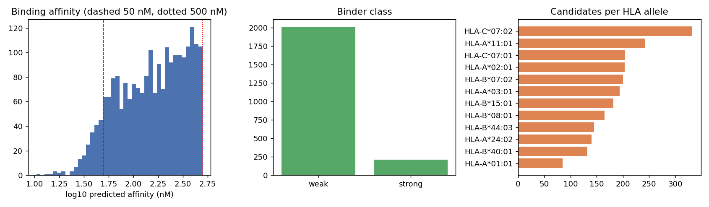
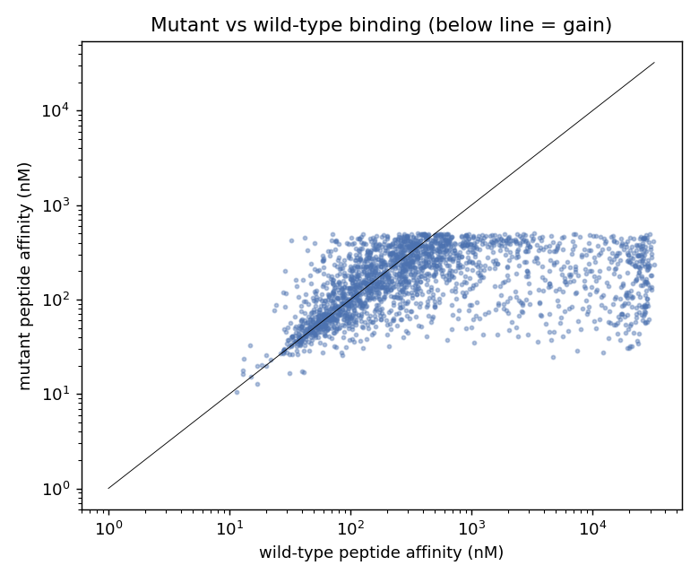
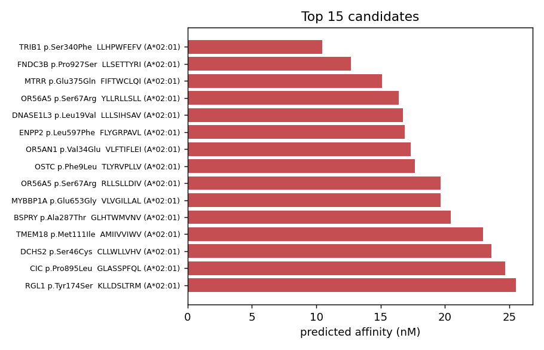

# neoantigen-prediction-mhcflurry

[](https://github.com/syed1789/neoantigen-prediction-mhcflurry/actions/workflows/ci.yml)

A real, working companion pipeline to
[nf-variant-pipeline](https://github.com/syed1789/nf-variant-pipeline)'s
`somatic.nf`: takes a somatic (tumor-normal) VCF, finds missense mutations,
translates each one into candidate 8-11mer peptides spanning the mutated
residue, and runs [MHCflurry](https://github.com/openvax/mhcflurry) to
predict MHC class I binding affinity against a panel of common HLA alleles —
producing a ranked list of candidate neoantigens.

```
somatic VCF (PASS SNVs)
        │
        ▼
  Ensembl VEP REST  ───────────  canonical-transcript missense_variant calls
        │                        (gene, transcript, HGVSp, protein position)
        ▼
  Ensembl REST protein sequence ─ wildtype protein, sanity-checked against
        │                         VEP's reported reference amino acid
        ▼
  8/9/10/11-mer windows  ──────  candidate mutant peptides spanning the
        │                        substituted residue
        ▼
  MHCflurry (Class1AffinityPredictor) ── predicted nM affinity per
        │                                peptide × HLA allele
        ▼
  ranked_neoantigen_candidates.tsv
```

## Why this exists

`nf-variant-pipeline` demonstrates the *calling* side of a clinical cancer
genomics pipeline (align, call, filter, annotate). This repo demonstrates the
next stage a genomics/immuno-oncology role actually asks about: turning a
somatic call set into a testable hypothesis about tumor-specific peptides
that could be presented on MHC class I and recognized by a T cell — the
actual computational step behind neoantigen vaccine and TIL-therapy pipelines
used in real translational oncology labs.

What a reader should take away from this repo:

- Real, correct genomic-coordinate-to-peptide translation (VCF position →
  transcript → protein position → amino acid substitution → peptide window),
  not a toy string manipulation exercise.
- Real use of a real, published, ML-based binding predictor (MHCflurry), run
  against real public somatic variant data, not synthetic/mocked output.
- An honest account (see [NEOANTIGEN.md](NEOANTIGEN.md)) of what MHCflurry's
  output actually means, what it doesn't mean, and the real bugs and
  limitations hit while building this — including a Python 3.13 stdlib
  incompatibility in MHCflurry itself, and why a public REST annotation
  service was used instead of a local SnpEff/VEP database (directly because
  of a documented limitation in the upstream pipeline).
- A [security review](SECURITY.md) covering the real risk surface of this
  specific pipeline: what data leaves the machine, container pinning,
  and injection risk at the Nextflow script-interpolation boundary.

## Real data used

[`test_data/high-confidence_sSNV_in_HC_regions_v1.2.1.vcf.gz`](test_data/)
is the SEQC2/GIAB Somatic Mutation Working Group's published high-confidence
somatic SNV call set for the **HCC1395 (tumor) / HCC1395BL (matched normal)**
breast cancer cell line pair — the same pair `nf-variant-pipeline`'s
`SOMATIC.md` names as the standard public benchmark for somatic calling. It
is real, publicly released, multi-platform-consensus-validated somatic
variant data (Fang et al., *Nature Biotechnology* 2021), not synthetic test
data — see [`test_data/HCC1395_truth_set_README.md`](test_data/HCC1395_truth_set_README.md)
for provenance, and NEOANTIGEN.md for why this file (rather than actually
re-running `somatic.nf` end to end) is what this repo's real-data
demonstration is built on.

This is genome-wide, real, and unfiltered for "interesting" genes —
including, as one of many independent hits, the well-known **TP53
p.Arg175His** hotspot mutation, one of the most frequently reported TP53
mutations in cancer generally. See [NEOANTIGEN.md](NEOANTIGEN.md) for the
full real result set and what it does and doesn't demonstrate.

## Requirements

- [Nextflow](https://www.nextflow.io/docs/latest/install.html) (>=23.10.0)
- Docker (`-profile docker`) — every process pulls a pinned container image
- or Python 3.11 + `pip install -r requirements.txt` (`-profile local`) —
  this is what was actually used to validate this pipeline end to end (see
  NEOANTIGEN.md for why 3.11, not whatever `python3` defaults to)
- Outbound HTTPS access to `rest.ensembl.org` (variant/sequence annotation)
  and, on first run, to GitHub releases (MHCflurry model weights, ~160MB,
  cached after the first download)

## Running it

```bash
# Docker (pulls pinned containers automatically)
nextflow run neoantigen.nf -profile docker \
    --vcf test_data/high-confidence_sSNV_in_HC_regions_v1.2.1.vcf.gz \
    --vcf_filter "PASS;HighConf"
```

```bash
# Local Python (what was actually run to produce example_results/)
python3.11 -m venv .venv && source .venv/bin/activate
pip install -r requirements.txt
mhcflurry-downloads fetch models_class1_pan

nextflow run neoantigen.nf -profile local \
    --vcf test_data/high-confidence_sSNV_in_HC_regions_v1.2.1.vcf.gz \
    --vcf_filter "PASS;HighConf"
```

Point `--vcf` at `nf-variant-pipeline/somatic.nf`'s own output
(`results_somatic/mutect2_filtered/<tumor_id>.filtered.vcf.gz`) to run this
against that pipeline's calls directly — with `--vcf_filter PASS`, its
default. This pipeline does its own VEP-based annotation regardless of
whether the input VCF already carries a SnpEff `ANN` field.

Useful parameters (all overridable, see `neoantigen.nf` for the full list):

| Parameter | Default | Meaning |
|---|---|---|
| `--vcf_filter` | `PASS` | Only variants with this exact FILTER value are annotated |
| `--chrom` | (all) | Restrict to specific chromosomes, e.g. `"17,21"` |
| `--hla_alleles` | 12-allele common panel | Comma-separated MHCflurry allele names |
| `--peptide_lengths` | `8,9,10,11` | Candidate peptide lengths generated |
| `--max_affinity_nm` | `500` | Affinity cutoff for the ranked output (standard "weak binder or better" threshold) |

## Output

- `results/annotated/*.missense_variants.json` — VEP-called missense variants
- `results/annotated/*.wildtype_sequences.json`, `*.verified_variants.json` —
  fetched protein sequences + sanity-checked variants (see NEOANTIGEN.md)
- `results/peptides/*.candidate_peptides.tsv` — every candidate peptide
- `results/predictions/*.raw_predictions.tsv` — every peptide × allele
  MHCflurry prediction (including sub-threshold ones)
- `results/predictions/*.ranked_neoantigen_candidates.tsv` — filtered,
  ranked candidate list
- `results/predictions/*.top_candidates.md` — top-N as a readable table

[`example_results/`](example_results/) has the actual, real, committed
output from running this pipeline against the full HCC1395 truth-set VCF —
see below and NEOANTIGEN.md.

## What's committed as example output

`example_results/` is not a fabricated or hand-written example — it's the
genuine output of `nextflow run neoantigen.nf -profile local` against
`test_data/high-confidence_sSNV_in_HC_regions_v1.2.1.vcf.gz`, committed so a
reader doesn't have to run the pipeline (and wait on VEP REST rate limits)
to see what it actually produces. Regenerate it yourself with the command
above to confirm.

## Security review

See [SECURITY.md](SECURITY.md) for the full pass. Headline items: every
container is pinned to a digest (not a floating tag), dependency versions
are pinned to what was actually tested, and — the one worth reading in
full if you plan to point this at real patient data rather than public
cell-line data — **this pipeline sends variant coordinates and peptide
sequences to a public third-party API (Ensembl) as part of normal
operation.** That's fine for HCC1395 (public, consented, non-patient
reference material) and not fine for real clinical VCFs without a
data-governance review first.

## Figures

Generated by `python bin/make_figures.py` from the committed ranked candidate table:



 

## Running on HPC (SLURM) and AWS

Includes a SLURM head-job script and a one-shot EC2 launcher (alongside the existing `slurm`/`awsbatch` profiles). See [HPC_AWS.md](HPC_AWS.md) for steps and what was verified.
